# ReQurv Bridge

[](./LICENSE)
[](https://github.com/ReQurv/requrv-bridge/actions)
[](https://github.com/ReQurv/requrv-bridge/releases)
[](https://github.com/ReQurv/requrv-bridge/releases)



ReQurv Bridge is a desktop application that launches your AI coding agents pre-configured for [AI Hive](https://hive.requrv.ai), the ReQurv AI gateway.

[-dmg-00DC82?logo=apple&logoColor=white)](https://github.com/ReQurv/requrv-bridge/releases/latest/download/ReQurv.Bridge_aarch64.dmg)
[](https://github.com/ReQurv/requrv-bridge/releases/latest/download/ReQurv.Bridge_x64-setup.exe)
[](https://github.com/ReQurv/requrv-bridge/releases/latest/download/ReQurv.Bridge_amd64.AppImage)


## Supported agents

| Harness | macOS | Windows | Linux |
| --- | --- | --- | --- |
| [OpenCode](https://opencode.ai) | App + CLI | App + CLI | App + CLI |
| [ChatGPT / Codex](https://chatgpt.com/codex) | ChatGPT Codex mode + CLI | ChatGPT Codex mode + CLI | CLI |
| [Claude Code](https://claude.com/product/claude-code) | CLI | CLI | CLI |
| [Claude Desktop](https://claude.com/download) | Chat in gateway mode | Chat in gateway mode | Desktop entry detection |
| [Hermes Agent](https://hermes-agent.nousresearch.com/) | App + CLI | App + CLI | CLI |

These are implemented targets, not a certification of every installer/version. See the [macOS and Windows validation procedure](docs/harness-validation.md) for the test matrix, expected behavior and remaining runtime checks.

## Features

- Save an AI Hive key locally, fetch the available models and choose a model.
- Detect app and CLI installations separately, including common Node version managers and Windows Store installations.
- Launch CLIs in a selected project directory using Terminal on macOS and a PowerShell console on Windows.
- Persist the Hive provider in each harness's native configuration, preserving unrelated settings. OpenCode, Codex/ChatGPT and Hermes share configuration between their desktop and CLI surfaces.
- Keep an initial backup and offer restore. Desktop applications already running require a confirmed restart to load configured or restored settings.
- Update already-managed configurations when the saved Hive key changes, including Hermes profiles and Claude Desktop.
- Distribute user-defined MCP servers to Claude Code, OpenCode and Claude Desktop.

OpenCode uses a `requrv-hive` provider in its global JSON/JSONC config. Codex and ChatGPT's Codex surface share `~/.codex/config.toml`, a generated model catalog and API-key authentication; the custom provider uses Responses over HTTP, with WebSocket disabled and `CODEX_HOME` pinned. Claude Code merges Anthropic gateway variables into `~/.claude/settings.json`. Hermes writes a named provider into its default and existing profile YAML configurations. Claude Desktop uses a third-party gateway profile, independently of Claude Code.

Configuration survives Bridge's exit. Restoring a shared configuration affects both surfaces and can return the whole file to the initial snapshot. ChatGPT's ordinary chat/voice and Claude Desktop's consumer Code tab are outside this routing. Claude Desktop's displayed Hive model depends on the gateway mapping its Anthropic-compatible model slot; verify the actual routed model during validation.

## Installation

Download the latest build for your platform from the [Releases page](https://github.com/ReQurv/requrv-bridge/releases):

| Platform | Packages                              |
| -------- | ------------------------------------- |
| macOS    | `.dmg` (and `.app.tar.gz`)            |
| Linux    | `.AppImage` and `.deb`                |
| Windows  | `.msi` (and NSIS `.exe` installer)    |

You need an AI Hive API key, which you paste into the app once (it is validated against the gateway and stored locally).

### Code signing

- **macOS**: release builds are code-signed (Developer ID) and notarized, so the app opens without any Gatekeeper warning
- **Windows**: the build is not code-signed. When SmartScreen shows "Windows protected your PC", click **More info** → **Run anyway**
- **Linux**: unsigned packages. If the AppImage won't start, grant it execute permission with `chmod +x ReQurv-Bridge_*.AppImage`

## Development

Requirements:

- [Bun](https://bun.sh)
- [Rust](https://rustup.rs) (for the Tauri backend)
- Tauri system dependencies: see the [prerequisites](https://tauri.app/start/prerequisites/)

Install the dependencies:

```bash
bun install
```

Start the app in development mode (Nuxt on `http://localhost:3001` + Tauri window):

```bash
bun run tauri dev
```

To develop the web part only (without Tauri; Tauri-bound features degrade automatically):

```bash
bun run dev
```

### Scripts

| Script              | Description                                       |
| ------------------- | ------------------------------------------------- |
| `bun run dev`       | Nuxt dev server (web only)                        |
| `bun run build`     | Production frontend build (SSG)                   |
| `bun run preview`   | Local preview of the production build             |
| `bun run tauri`     | Tauri CLI (`dev`, `build`, etc.)                  |
| `bun run build:mac` | Signed + notarized macOS release build (reads Apple credentials from the gitignored `.env`) |
| `bun run lint`      | ESLint                                            |
| `bun run typecheck` | Typecheck with `nuxt typecheck` / `vue-tsc`       |

Rust tests:

```bash
cd src-tauri
cargo test
```

## Project structure

```
app/                  # Nuxt frontend (UI, useHive composable)
src-tauri/            # Tauri backend (commands, service detection, launch)
public/               # Static assets (logo, favicon)
docs/                 # Documentation assets
```

Tauri commands exposed to the frontend (`src-tauri/src/commands.rs`):

- `get_hive_key` / `set_hive_key` / `delete_hive_key` — key management (stored in `hive.json` in the app config folder, with a `.bak` backup)
- `list_hive_models` — lists models from the gateway `GET /models`
- `check_services` — detects installed agents (and whether ChatGPT.app is configured for Hive)
- `launch_service` — configures and launches the selected service
- `configure_chatgpt_app` / `open_chatgpt_app` / `restart_chatgpt_app` / `restore_chatgpt_app` — configure, open, restart and restore ChatGPT.app on AI Hive

## Releases

Local build of the binaries and bundles:

```bash
bun run tauri build
```

Releases are automated: CI (`.github/workflows/build.yml`) builds for macOS, Linux and Windows and publishes a GitHub Release whenever a `v*` tag is pushed. The macOS bundle is code-signed (Developer ID) and notarized using repository secrets.

## CI

CI (`.github/workflows/ci.yml`) runs frontend lint/typecheck and Rust tests plus Clippy on macOS, Windows and Linux on every push. Real-device launch, streaming and tool-use checks are tracked separately in the [validation procedure](docs/harness-validation.md).

## Contributing

Contributions are welcome — especially new agent connectors. See [CONTRIBUTING.md](./CONTRIBUTING.md) for development setup, code conventions and a step-by-step guide for adding a new connector.

- [Code of Conduct](./CODE_OF_CONDUCT.md)
- [Security policy](./SECURITY.md)

## License

[GPL-3.0-or-later](./LICENSE) © 2025-2026 ReQurv
